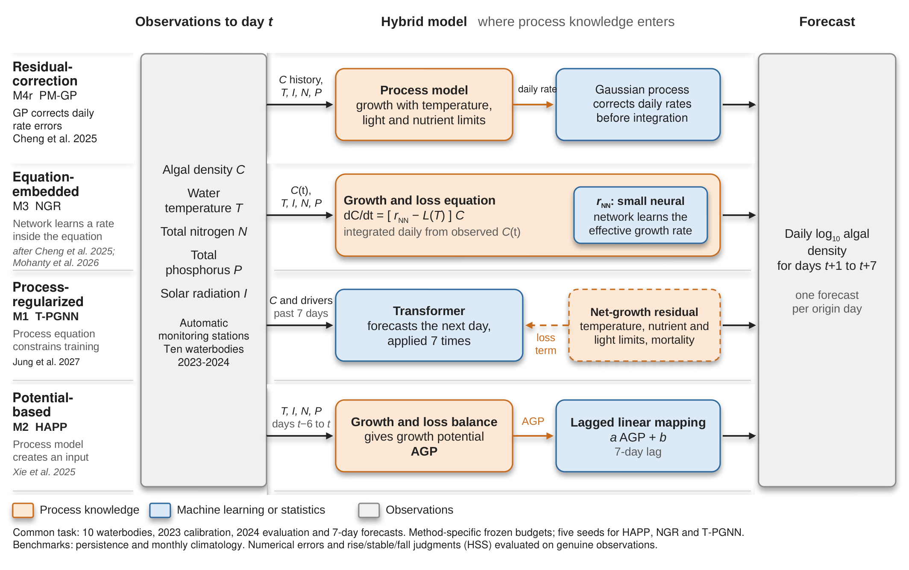

# Algal Bloom Hybrid Benchmark

**Four ways to combine process models and AI. Ten waterbodies. Seven-day forecasts.**

English · [简体中文](README_zh.md)

[](requirements-analysis.txt) [](LICENSE) [](https://github.com/Elio-SiChien/algal-bloom-hybrid-benchmark/releases/tag/v1.0.0-review)

[Quick start](#quick-start) · [Code & data](#code-and-data) · [Reproduction evidence](#reproduction-status) · [Review release](https://github.com/Elio-SiChien/algal-bloom-hybrid-benchmark/releases/tag/v1.0.0-review)

Reproduce the numerical results of *Where process knowledge should enter machine learning for 7-day algal bloom forecasting*. This repository is for reviewers checking the experiments and researchers reusing the four implementations.

**Start with `results`: no GPU, private data path or API account is needed.** It downloads the fixed prediction archive and recalculates metrics and figures from forecasts and real observations.

<a id="quick-start-reproduce-the-papers-numerical-results"></a>
## Quick start

Use **Python 3.10** and Git. The reference validation used Python 3.10.9 on Windows; Linux/macOS have not been independently validated.

```bash
git clone https://github.com/Elio-SiChien/algal-bloom-hybrid-benchmark.git
cd algal-bloom-hybrid-benchmark
python -m venv .venv
```

Windows — run without activating the environment:

```powershell
.venv\Scripts\python.exe -m pip install -r requirements-analysis.txt
.venv\Scripts\python.exe reproduce.py --mode results
```

<details>
<summary>Linux/macOS commands</summary>

```bash
.venv/bin/python -m pip install -r requirements-analysis.txt
.venv/bin/python reproduce.py --mode results
```

</details>

After a successful run, open `outputs/results_<timestamp>/verification.json`. The same directory contains recomputed tables, PNG/PDF result figures and quality-control plots. The prediction download is about **14.3 MB**. Missing inputs, checksum failures or numerical mismatches stop the run. Frozen inputs and reference results are not overwritten.

See [offline use, outputs and advanced commands](docs/REPRODUCING.md).

<a id="code-and-data"></a>
<a id="are-the-code-and-data-included"></a>
## Code and data

**This repository provides the core code and ten-station inputs; formal predictions are distributed through the public Release.**

| Material | Location | What is included |
|---|---|---|
| Four hybrid algorithms + baselines | [experiments/](experiments/) | Model code, preprocessing, CV, scoring, plotting and frozen search ranges |
| Selected raw observations | [intermediate/](data/study_lakes/v3/intermediate/) | Ten station subsets and pre-interpolation daily records |
| Model-ready inputs | [V3 data](data/study_lakes/v3/) | Daily algal density, water temperature, TN/TP, weather, observation/fill flags and origins |
| Formal forecasts | [Review Release](https://github.com/Elio-SiChien/algal-bloom-hybrid-benchmark/releases/tag/v1.0.0-review) | `formal-predictions-v3.zip`: final and seed predictions, score JSON, selected configurations and fit summaries |
| Reference tables and provenance | [reference/](reference/) | Expected numerical tables, source hashes, original environment records and physical-source links |

The Release ZIP has **250 checksum-verified members**. It is fetched automatically by `results`, so cloning alone does not download the formal prediction archive. The full national source archive and complete pretrained checkpoints are not included; they are not needed to recompute the published results.

<a id="what-is-reproduced"></a>
<a id="reproduction-status"></a>
## Reproduction scope and verification

The fixed review source and prediction archive were downloaded anonymously into a new directory and checked again.

| Task | Actual verification |
|---|---|
| Recalculate paper metrics, tests and numerical figures | **Passed:** 360 full-precision comparisons; largest difference `4.44e-16` (tolerance `1e-10`) |
| Rebuild daily data and forecast origins | **Passed:** reconstructed from the ten raw station subsets |
| Run all four training–prediction pipelines | **Passed at smoke-test scale:** one waterbody, reduced budgets, held-out 2023 data |
| Retrain all four methods across all ten waterbodies | Entry provided; **not fully rerun or verified** for this release |
| Load four ready-made pretrained models | **Not available:** complete checkpoints were not retained |

[Read the verification report](docs/VERIFICATION.md) · [Public-download proof](docs/PUBLICATION.md)

This verifies numerical result reproduction and small-scale pipeline execution. It does not establish exact full-training replication across operating systems or GPUs. The badges above describe runtime, code licence and an existing release; they are not live CI results.

<a id="four-method-smoke-test-and-full-training"></a>
<a id="rebuild-the-selected-station-daily-data"></a>
<a id="choose-a-workflow"></a>
## Execution modes

Below, `python` means your virtual-environment interpreter: `.venv\Scripts\python.exe` on Windows or `.venv/bin/python` on Linux/macOS. Use it just as in the quick start, or activate the environment first.

| Mode | Command after environment setup | Purpose |
|---|---|---|
| Results | `python reproduce.py --mode results` | Recompute paper metrics and figures without training |
| Prepare | `python reproduce.py --mode prepare` | Rebuild and compare the ten-station daily inputs |
| Smoke | `python reproduce.py --mode smoke` | Exercise all four methods on CPU at small budgets |
| Train | `python reproduce.py --mode train --method all --site all` | Start the full frozen experiment; computationally expensive |

`smoke` and `train` need additional dependencies. Formal T-PGNN defaults to an NVIDIA CUDA environment; smoke mode uses its existing CPU test switch. **Follow [training setup](docs/REPRODUCING.md#four-method-smoke-test-and-full-training) before these modes.** Do not expect the lightweight analysis installation to support full training.

Run the input-integrity and failure checks with:

```bash
python -m unittest discover -s tests -v
```

<a id="what-is-being-compared"></a>
## Study and integration mechanisms

| Mechanism | Method | How process knowledge enters |
|---|---|---|
| Correction | PM-GP | AI corrects process-model daily growth-rate errors before integration |
| Inside | NGR | Retain the growth–loss equation; learn its growth-rate term |
| Alongside | T-PGNN | Penalize departures from process relationships during network training |
| Potential | HAPP | Calculate environmental growth potential, then map it to future density |

[](assets/Fig1_hybrid_framework.pdf)

Four process–AI integration mechanisms and the common seven-day forecasting task. Click the figure to open the original PDF.

<a id="scientific-conditions-to-retain"></a>
Models are fitted separately per waterbody on **2023** and evaluated on **2024**. Scoring excludes interpolated targets. Future weather is **ERA5-Land reanalysis**, not an operational weather forecast. Budgets differ by method; the comparison concerns these four concrete implementations. See [method sources and adaptations](docs/METHODS.md).

<a id="reuse-and-citation"></a>
## Reuse, citation and review

- [MIT](LICENSE) covers original code. Third-party data retain their [source-specific terms](DATA_LICENSE.md); data are not collectively relicensed as MIT.
- Cite this tagged software using [CITATION.cff](CITATION.cff), alongside the upstream model and data sources. A paper DOI is not yet assigned here.
- To report a reproduction issue, include the release tag, command, package versions and error message in [GitHub Issues](https://github.com/Elio-SiChien/algal-bloom-hybrid-benchmark/issues). Remove private paths or credentials from logs.

| Documentation | Contents |
|---|---|
| [Detailed reproduction guide](docs/REPRODUCING.md) | Dependencies, offline prediction ZIP, outputs and formal experiment conditions |
| [Data dictionary](docs/DATA.md) | Fields, units, masks and source-versus-subset hashes |
| [Methods](docs/METHODS.md) | Published frameworks, actual adaptations and historical-comment caveats |
| [Verification](docs/VERIFICATION.md) | What passed, what was not tested and environmental limits |
| [Third-party notices](THIRD_PARTY_NOTICES.md) | Data, cartography and software attribution |

<sub>README layout informed by [Best-README-Template](https://github.com/othneildrew/Best-README-Template); project text and scientific content are specific to this benchmark.</sub>
