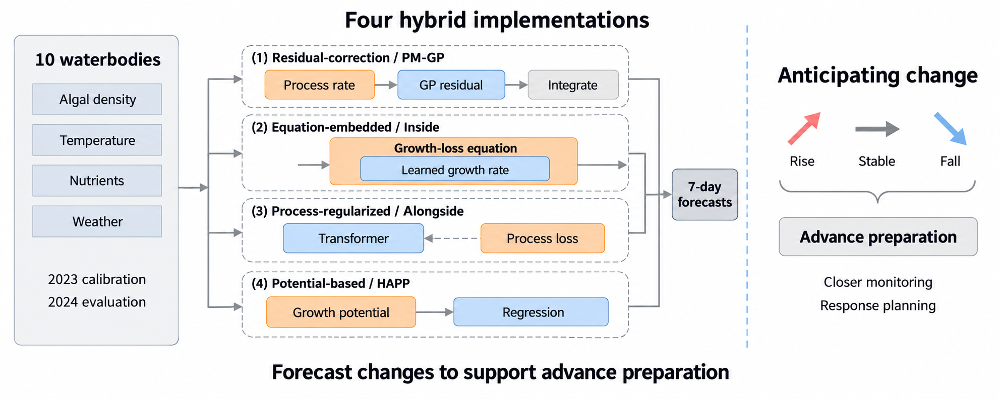

# 十水体机理–AI水华预测基准

**四种耦合方式 · 十个湖泊与水库 · 未来连续七天预测**

[English](README.md) · 简体中文

[](requirements-analysis.txt) [](LICENSE) [](https://github.com/Elio-SiChien/algal-bloom-hybrid-benchmark/releases/tag/v1.0.0-review)

[快速开始](#快速开始) · [代码与数据](#代码与数据都上传了吗) · [复现证据](#别人能复现到什么程度) · [固定审稿版本](https://github.com/Elio-SiChien/algal-bloom-hybrid-benchmark/releases/tag/v1.0.0-review)

本仓库配套论文 *Where process knowledge should enter machine learning for 7-day algal bloom forecasting*，供审稿人检查实验，也供研究者复用四种机理–AI方法。

**建议先运行 `results`：不需要GPU、私人数据路径或API账号。** 程序下载固定版本的预测包，从预测与真实观测重新计算论文指标和图表，而不是直接复制已有结果表。

## 快速开始

需要Git和 **Python 3.10**。已验证环境是Windows下的Python 3.10.9；Linux/macOS命令一并提供，但尚未独立验收。

```bash
git clone https://github.com/Elio-SiChien/algal-bloom-hybrid-benchmark.git
cd algal-bloom-hybrid-benchmark
python -m venv .venv
```

Windows无需激活环境，直接运行：

```powershell
.venv\Scripts\python.exe -m pip install -r requirements-analysis.txt
.venv\Scripts\python.exe reproduce.py --mode results
```

<details>
<summary>Linux/macOS命令</summary>

```bash
.venv/bin/python -m pip install -r requirements-analysis.txt
.venv/bin/python reproduce.py --mode results
```

</details>

成功后查看 `outputs/results_<timestamp>/verification.json`。同目录保存重算的表格、PNG/PDF结果图和质控图。预测附件约 **14.3 MB**；文件缺失、哈希错误或数值不一致会终止运行，不使用示例数据替代。冻结输入和参考结果不会被覆盖。

离线使用、完整输出及进阶命令见[详细复现指南](docs/REPRODUCING.md)。

## 代码与数据都上传了吗？

**已上传。核心代码和十站输入在Git仓库，正式预测在公开Release附件。**

| 内容 | 位置 | 包含什么 |
|---|---|---|
| 四种算法及基准 | [experiments/](experiments/) | 模型实现、预处理、交叉验证、评价、绘图及冻结搜索范围 |
| 实验原始观测 | [intermediate/](data/study_lakes/v3/intermediate/) | 十站原始观测子集及插值前日记录 |
| 可直接使用的输入 | [V3数据目录](data/study_lakes/v3/) | 日藻密度、水温、TN/TP、气象、真实/插值标记及预测起点 |
| 正式预测 | [审稿版Release](https://github.com/Elio-SiChien/algal-bloom-hybrid-benchmark/releases/tag/v1.0.0-review) | `formal-predictions-v3.zip`，含各随机种子及最终预测、评分JSON、选定配置和参数摘要 |
| 对照表和溯源 | [reference/](reference/) | 预期指标表、源文件哈希、原运行环境记录和物理资料来源 |

预测ZIP有 **250个逐一校验的文件成员**。`results`会自动下载，因此仅克隆仓库时不会同时下载正式预测附件。全国原始数据全集和完整预训练模型权重不在本包中；重算论文结果不依赖它们。

## 别人能复现到什么程度？

已将固定审稿版本和预测包匿名下载到新目录，再次执行以下检查：

| 任务 | 已完成的实际验证 |
|---|---|
| 论文指标、检验与数值图表重算 | **通过**：360项全精度比较，最大差异`4.44e-16`，容差`1e-10` |
| 原始子集重建日数据及起点 | **通过**：由十站原始观测重新处理 |
| 四法训练—七日预测流程 | **小规模试跑通过**：一个水体、缩减预算、2023年内留出验证 |
| 四法×十水体完整重新训练 | 已提供入口；**本轮未完整重跑及验收** |
| 直接加载四法预训练模型 | **不提供**：完整模型检查点未保存 |

[详细核验报告](docs/VERIFICATION.md) · [公开下载复核证据](docs/PUBLICATION.md)

当前有实证支持的是“论文数值结果可重算、四法小规模流程能运行”，不能据此声称不同操作系统/GPU上的完整训练结果必然一致。上方徽章仅表示运行版本、代码许可和已存在的Release，不是实时CI通过标记。

## 按需要选择运行方式

下表中的`python`指刚建立的虚拟环境解释器：Windows用`.venv\Scripts\python.exe`，Linux/macOS用`.venv/bin/python`；与快速开始保持一致，或先激活虚拟环境。

| 模式 | 环境安装后的命令 | 用途 |
|---|---|---|
| results | `python reproduce.py --mode results` | 不训练，重算论文指标与图表 |
| prepare | `python reproduce.py --mode prepare` | 从十站原始子集重建并比较日数据 |
| smoke | `python reproduce.py --mode smoke` | 在CPU上以小预算试跑四种方法 |
| train | `python reproduce.py --mode train --method all --site all` | 启动冻结配置下的完整实验，计算量较大 |

`smoke`和`train`需要额外安装训练依赖。正式T-PGNN默认需要NVIDIA CUDA环境，小规模试跑使用源码已有CPU测试开关。**运行前请看[训练环境说明](docs/REPRODUCING.md#four-method-smoke-test-and-full-training)**，不要把轻量分析环境当成完整训练环境。

完整性与故障拒绝测试：

```bash
python -m unittest discover -s tests -v
```

## 四种方法具体怎样结合？

| 好记的标签 | 方法 | 耦合机制 |
|---|---|---|
| 纠错型 Correction | PM-GP | 用AI订正机理模型的逐日增长率误差，再积分推算藻量 |
| 内部替代 Inside | NGR | 保留增长—损失方程，让AI计算增长率项 |
| 并行约束 Alongside | T-PGNN | 将偏离机理关系的程度加入网络训练损失 |
| 潜力驱动 Potential | HAPP | 先计算环境生长潜力，再映射为未来藻量 |



各水体分别使用 **2023年训练、2024年评价**；评价排除插值目标日。未来气象采用 **ERA5-Land事后再分析**，不是实际发布的天气预报。四法预算各有预设，本研究比较具体实现，不将差异完全归因于耦合位置。详见[方法来源与适配](docs/METHODS.md)。

## 复用、引用与反馈

- 原创代码采用[MIT许可](LICENSE)。第三方数据保留[各自的来源条件](DATA_LICENSE.md)，没有统一改为MIT。
- 引用本仓库固定版本时使用[CITATION.cff](CITATION.cff)，同时引用上游方法与数据来源；当前不填尚未确定的论文DOI。
- 若复现遇到问题，可在[GitHub Issues](https://github.com/Elio-SiChien/algal-bloom-hybrid-benchmark/issues)留下版本、命令、依赖版本和错误信息，提交前移除日志中的个人路径与凭据。

| 文档 | 内容 |
|---|---|
| [详细复现指南](docs/REPRODUCING.md) | 依赖、离线预测包、输出和正式实验条件 |
| [数据字典](docs/DATA.md) | 字段、单位、观测掩码及原来源/公开子集哈希 |
| [方法说明](docs/METHODS.md) | 论文框架、实际适配及历史注释的解释 |
| [核验报告](docs/VERIFICATION.md) | 已通过检查、未验证事项及环境边界 |
| [第三方来源](THIRD_PARTY_NOTICES.md) | 数据、制图与软件署名 |

<sub>首页布局参考[Best-README-Template](https://github.com/othneildrew/Best-README-Template)，正文和科学内容按本研究重新组织。</sub>
